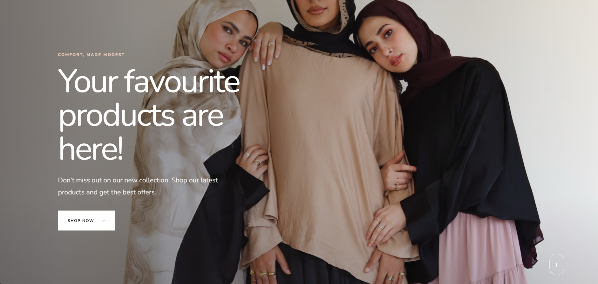

# Clothes Brand Website
A full stack clothing brand website with a React frontend and an Express.js backend connected to a MySQL database.

## [**View Live Demo**](https://clothes-website-tau-one.vercel.app/)



## Features
- [Feature 1, e.g. product pages]
- [Feature 2, e.g. cart or orders]
- [Feature 3]

## Tech Stack
- **Frontend:** React.js, React Router, Bootstrap, Vite
- **Backend:** Node.js, Express.js
- **Database:** MySQL

## Run Locally
```bash
git clone https://github.com/rawanelgaml23/Clothes-Website.git
cd Clothes-Website
npm install
```
Create a `.env` file with your MySQL settings: [list your variable names, e.g. host, user, password, database].

```bash
npm run backend   # start the API server
npm run dev       # start the frontend (in a second terminal)
```
